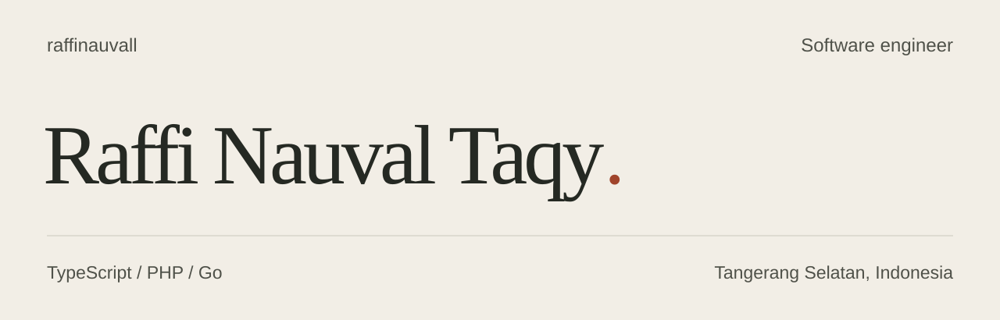
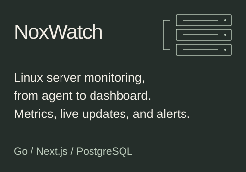
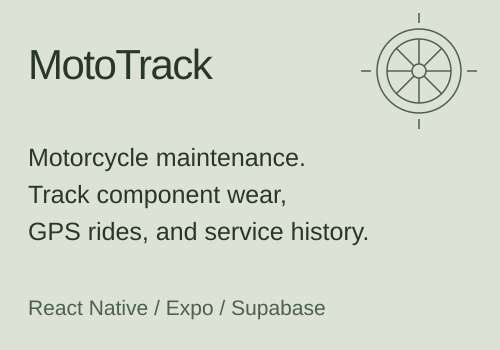

<picture>
  <source media="(max-width: 1000px)" srcset="./assets/profile-mobile.svg">
  
</picture>

<br>

I build web applications and backend services. Here are two projects I've been working on.

## Selected work

<p>
  <a href="https://github.com/raffinauvall/noxwatch"></a>
  <a href="https://github.com/raffinauvall/moto-track"></a>
</p>

<br>

<details>
<summary><strong>Coding activity</strong> · All-time WakaTime stats</summary>

<!--START_SECTION:waka-->

```text
TypeScript                 161 hrs 11 mins       ██████▒░░░░░░░░░░░░░░░░░░   25.59 %
PHP                        104 hrs 29 mins       ████░░░░░░░░░░░░░░░░░░░░░   16.59 %
Go                         80 hrs 32 mins        ███▒░░░░░░░░░░░░░░░░░░░░░   12.79 %
JavaScript                 57 hrs 13 mins        ██▒░░░░░░░░░░░░░░░░░░░░░░   09.08 %
Java                       55 hrs 30 mins        ██▒░░░░░░░░░░░░░░░░░░░░░░   08.81 %
```

<!--END_SECTION:waka-->

</details>

<br>

<sub><em>Making mistakes is better than faking perfection.</em></sub>
